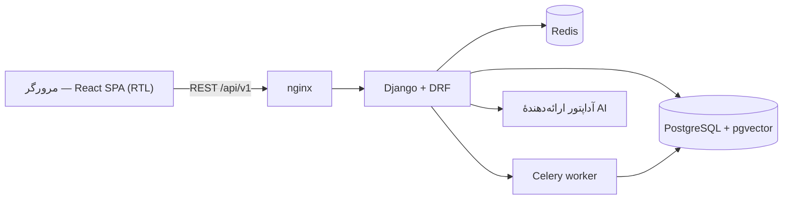
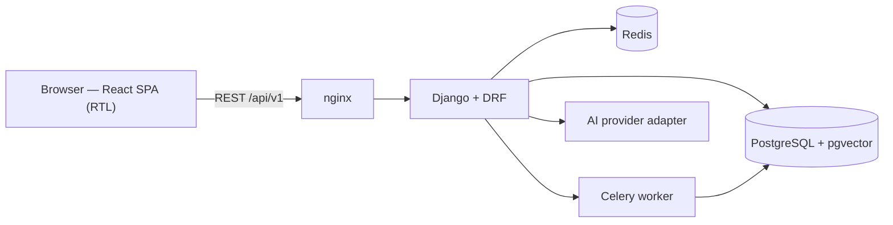

<div dir="rtl">

# دستیار هوشمند دانشگاهی — Uni AI Assistant

> پاسخ‌های قابل اعتماد برای پرسش‌های آموزشی و اداری دانشجویان، بر پایهٔ داده‌های رسمی دانشگاه و اسناد مصوب — همراه با ذکر منبع.

[](https://github.com/parsaLupo/Uni-AI-Assistant/actions/workflows/ci.yml)
[](https://github.com/parsaLupo/Uni-AI-Assistant/releases/tag/v1.0.0)
[](#مجوز)

**نسخهٔ پایدار:** `v1.0.0` — اولین انتشار پایدار محلی
**زبان و جهت:** فارسی‌محور، راست‌به‌چپ (RTL)
**دامنه:** استقرار محلی با Docker Compose روی `http://localhost:8080`
**دادهٔ پایه:** دانشگاه سمنان — نیمسال اول ۱۴۰۵–۱۴۰۶ (دو دانشکده)

---

## دربارهٔ پروژه

«دستیار هوشمند دانشگاهی» یک سامانهٔ وب فارسی و RTL است که به دانشجویان کمک می‌کند پاسخ پرسش‌های خود دربارهٔ دروس، پیش‌نیازها، ترم‌ها، برنامهٔ هفتگی، امتحانات، دروس اخذشده و آیین‌نامه‌های آموزشی را دریافت کنند.

اصل طراحی این است که **هوش مصنوعی منبع حقیقت نیست**:

1. داده‌های ساخت‌یافتهٔ رسمی در PostgreSQL اولویت اول هستند.
2. اسناد رسمی ایندکس‌شده در سامانهٔ RAG اولویت دوم هستند.
3. اعلان‌ها و محتوای تأییدشدهٔ مدیران اولویت سوم هستند.
4. دانش عمومی مدل فقط برای توضیحات غیردانشگاهی استفاده می‌شود.

قواعد قطعی (مانند احراز پیش‌نیاز یا تداخل زمانی) در بک‌اند محاسبه می‌شوند و مدل زبانی تنها اجازهٔ **توضیح** نتیجه را دارد؛ هرگز نمی‌تواند آن را نقض کند.

---

## دامنهٔ داده

این نسخه بر پایهٔ اطلاعات **دانشگاه سمنان برای نیمسال اول ۱۴۰۵–۱۴۰۶** ساخته شده است و در حال حاضر فقط دو دانشکده را پوشش می‌دهد:

- دانشکدهٔ مهندسی برق و کامپیوتر
- دانشکدهٔ مهندسی مواد و متالورژی

ساختار داده و کد به‌گونه‌ای طراحی شده است که افزودن دانشکده‌ها، گروه‌ها و رشته‌های دیگر فقط با وارد کردن دادهٔ رسمی جدید و بدون تغییر در معماری سامانه امکان‌پذیر باشد.

---

## قابلیت‌ها

### دانشجو

- ثبت‌نام و ورود با ایمیل؛ نقش‌ها: `STUDENT`، `PROFESSOR`، `ADMIN`، `SUPERADMIN`.
- داشبورد شخصی، تکمیل پروفایل (نام، شمارهٔ دانشجویی، رشته) و نمایش معدل.
- مرور دانشکده‌ها، گروه‌ها، دروس، پیش‌نیازها، استادان، ترم‌ها، ارائه‌های درس، برنامهٔ هفتگی و امتحانات.
- جست‌وجوی فارسی با نرمال‌سازی کامل: ی/ي، ک/ك، ه/ۀ، نیم‌فاصله (ZWNJ)، ارقام فارسی/لاتین و حذف کشیده.
- تاریخ‌های شمسی و اعداد فارسی در تمام رابط کاربری.
- انتخاب درس با موتور قواعد قطعی: کنترل پیش‌نیاز، ظرفیت و ارائهٔ ترم جاری، سقف واحد، درس تکراری/گذرانده و تداخل زمانی — همراه با دلیل ماشین‌خوان برای هر رد.
- برنامه‌ریز ترم (افزودن، جابه‌جایی و حذف درس) بر پایهٔ ردیف‌های برنامهٔ هفتگی.
- اعلان‌های درون‌برنامه‌ای با وضعیت خوانده/نخوانده، شمارنده و «همه را خوانده کن».
- گفتگو با دستیار، تاریخچهٔ پایدار، تغییر نام و حذف گفتگو، و کارت منبع برای هر پاسخ.

### دستیار هوش مصنوعی

- مسیریابی پرسش به یکی از حالت‌های `STRUCTURED`، `RAG`، `HYBRID`، `GENERAL` یا `OUT_OF_SCOPE`.
- پاسخ ساخت‌یافته از دیتابیس برای پرسش‌های درسی و ترم‌محور (بدون انحراف به RAG).
- پاسخ مبتنی بر سند برای آیین‌نامه‌ها، همراه با منبع، شمارهٔ صفحه و بخش.
- ترکیب هر دو منبع در پرسش‌های ترکیبی، با تفکیک اینکه هر ادعا از کجا آمده است.
- امتناع صریح و فارسی در صورت نبود شواهد کافی — بدون ساختن تاریخ، عدد یا مقرره.
- کنترل تزریق دستور (Prompt Injection): متن اسناد به‌عنوان «داده» و نه «دستور» تلقی می‌شود.
- آداپتور مستقل از ارائه‌دهنده: `mock` برای دموی آفلاین و اجرای قطعی تست‌ها؛ ارائه‌دهندهٔ واقعی اختیاری و فقط سمت سرور.

### مدیریت

- مدیریت کاربران و نقش‌ها و ورود گروهی دانشجویان (Student Import Wizard).
- مدیریت دروس، استادان، ترم‌ها، امتحانات، اعلان‌ها و اسناد.
- بارگذاری PDF با اعتبارسنجی پسوند، MIME، اندازه و امضای فایل؛ پردازش ناهمگام در Celery.
- چرخهٔ عمر سند: `Uploaded → Validating → Processing → Indexed → Active → Superseded/Inactive → Archived`.
- نسخه‌بندی و جایگزینی سند، تلاش مجدد پس از خطا بدون بارگذاری دوباره، و ثبت audit برای عملیات حساس.
- داشبورد تحلیلی مدیر و نمایش گزارش audit (فقط خواندنی).

### زیرساخت و عملیات

- سه probe سلامت: `/health/live/`، `/health/ready/`، `/health/deep/`.
- لاگ ساخت‌یافته با شناسهٔ درخواست (request-id) و بدون توکن/گذرواژه/دادهٔ شخصی اضافی.
- اسکریپت‌های آماده برای استقرار، تست دود، پشتیبان‌گیری، بازیابی، تمرین بازگشت و اسکن اسرار.
- استقرار کامل با Docker Compose: PostgreSQL + pgvector، Redis، بک‌اند Gunicorn، worker و nginx.

---

## معماری



- فرانت‌اند فقط از طریق REST با بک‌اند صحبت می‌کند و هرگز به دیتابیس یا کلید ارائه‌دهندهٔ AI دسترسی ندارد.
- منطق دامنه و قواعد کسب‌وکار در بک‌اند است؛ کامپوننت‌های React فقط نمایش و تعامل.
- قرارداد API در [`openapi.yaml`](openapi.yaml) نگهداری و در CI اعتبارسنجی می‌شود (بدون drift).

---

## پشتهٔ فناوری

| لایه | فناوری |
|---|---|
| فرانت‌اند | React 19.3، TypeScript 7، Vite 8، Tailwind CSS 4، TanStack Query 5، React Router 7، react-hook-form |
| بک‌اند | Django 5.2 LTS، Django REST Framework 3.18، Gunicorn 23 |
| دیتابیس | PostgreSQL 16 + pgvector 0.8.6 (ایندکس HNSW) — تنها موتور پشتیبانی‌شده، بدون جایگزین SQLite |
| پردازش پس‌زمینه | Celery 5.6 + Redis 8 |
| هوش مصنوعی | آداپتور مستقل؛ `mock` پیش‌فرض و ارائه‌دهندهٔ واقعی اختیاری (فقط سمت سرور) |
| سرو محلی | nginx برای بیلد استاتیک + reverse proxy، Docker Compose |
| مستندسازی API | drf-spectacular (OpenAPI 3.1) |
| استخراج PDF | pypdf 6.21 |
| زبان‌های اجرا | Python 3.13، Node.js 22 |

---

## شروع سریع (دموی محلی)

### پیش‌نیازها

- Docker Desktop (یا Docker Engine + Compose v2)
- حدود ۸ گیگابایت رم توصیه می‌شود
- آزاد بودن پورت `8080`

### نصب یک‌مرحله‌ای (Windows / PowerShell)

```powershell
git clone https://github.com/parsaLupo/Uni-AI-Assistant.git
cd Uni-AI-Assistant
powershell -ExecutionPolicy Bypass -File scripts/init-env.ps1
powershell -ExecutionPolicy Bypass -File scripts/deploy-local.ps1
```

`init-env.ps1` فایل `.env` را با اسرار تصادفی محلی می‌سازد و `deploy-local.ps1` مراحل build → migrate → seed → start → readiness را انجام می‌دهد.

سپس باز کنید: **<http://localhost:8080>**

### اجرای دستی

```bash
cp .env.example .env
# همهٔ مقادیر __CHANGE_ME__ را در .env جایگزین کنید.

docker compose up -d --build db redis
docker compose run --rm backend python manage.py migrate --noinput
docker compose run --rm backend python manage.py seed_demo
docker compose up -d --build
```

مهاجرت‌ها عمداً یک مرحلهٔ جدا و کنترل‌شده هستند؛ `docker compose up` هرگز خودکار migrate نمی‌کند.

> راهنمای کامل استقرار، متغیرها، عیب‌یابی، پشتیبان‌گیری و بازگشت: **[DEPLOYMENT.md](DEPLOYMENT.md)**

---

## حساب‌های دمو

هر چهار حساب با مقدار `DEMO_PASSWORD` در فایل محلی `.env` وارد می‌شوند:

| نقش | ایمیل |
|---|---|
| SUPERADMIN | `root@semnan.local` |
| ADMIN | `admin@semnan.local` |
| STUDENT | `student@semnan.local` |
| PROFESSOR | `professor@semnan.local` |

برای دیدن گذرواژهٔ محلی (خروجی را هرگز commit یا منتشر نکنید):

```powershell
scripts/show-demo-credentials.ps1
```

بدون تنظیم `DEMO_PASSWORD`، دستور `seed` داده‌های آموزشی را وارد می‌کند اما حساب‌های دمو ساخته نمی‌شوند.

---

## آدرس‌ها

| کاربرد | آدرس |
|---|---|
| برنامه | <http://localhost:8080> |
| سلامت API | <http://localhost:8080/api/v1/health/> |
| Liveness | `/health/live/` |
| Readiness | `/health/ready/` |
| Deep health | `/health/deep/` |
| Swagger UI | <http://localhost:8080/api/v1/schema/swagger-ui/> |

---

## متغیرهای محیطی مهم

فهرست کامل و توضیح هر متغیر در [`.env.example`](.env.example) و [DEPLOYMENT.md](DEPLOYMENT.md) آمده است.

| متغیر | توضیح |
|---|---|
| `DEPLOYMENT_MODE` | `dev` یا `local-demo` یا `release`؛ اعتبارسنجی شروع، پیش‌فرض‌های ناامن را رد می‌کند |
| `APP_PORT` | پورت سرو برنامه (پیش‌فرض `8080`) |
| `DJANGO_SECRET_KEY` | کلید امنیتی جنگو — هرگز مقدار واقعی را commit نکنید |
| `DJANGO_DEBUG` | در محیط غیرتوسعه باید `false` باشد |
| `ALLOWED_HOSTS` / `CORS_ALLOWED_ORIGINS` | فهرست صریح دامنه‌ها |
| `POSTGRES_*` / `DATABASE_URL` | اتصال PostgreSQL؛ SQLite پشتیبانی نمی‌شود |
| `CELERY_*` | آدرس Redis و تنظیمات worker |
| `AI_PROVIDER` | `mock` (پیش‌فرض) یا ارائه‌دهندهٔ واقعی |
| `AI_PROVIDER_API_KEY` | فقط سمت بک‌اند؛ هرگز به مرورگر نمی‌رسد |
| `EMBEDDING_MODEL` | مدل/شناسهٔ embedding برای pgvector |
| `DEMO_MODE` / `DEMO_PASSWORD` | ساخت حساب‌های دمو فقط برای محیط محلی |
| `COOKIE_SECURE` / `SECURE_SSL_REDIRECT` / `SECURE_HSTS_SECONDS` | پرچم‌های امنیتی HTTPS (در استقرار محلی HTTP غیرفعال‌اند) |
| `RATE_AUTH_IP` / `RATE_AUTH_REFRESH` / `RATE_AI_ASK` / `RATE_UPLOAD` | محدودیت نرخ ورود، تازه‌سازی توکن، پرسش AI و بارگذاری |
| `BACKUP_RETENTION_DAYS` | نگهداری پشتیبان‌ها (پیش‌فرض ۱۴ روز) |
| `GUNICORN_*` | تعداد worker/thread و timeout |

---

## دستورات رایج

| محل اجرا | دستور | کار |
|---|---|---|
| ریشه | `scripts/test-backend.ps1` | کل تست‌های بک‌اند روی PostgreSQL + pgvector موقت |
| ریشه | `scripts/smoke-test.ps1` | تست دود پس از استقرار (سلامت، ورود، خواندن، انتخاب درس، ماندگاری، پاسخ AI) |
| ریشه | `scripts/backup.ps1` | پشتیبان زمان‌دار PostgreSQL و اعتبارسنجی آرشیو |
| ریشه | `scripts/restore-drill.ps1` | بازیابی در دیتابیس موقت و بررسی صحت |
| ریشه | `scripts/restore.ps1` | بازیابی کنترل‌شده از فایل پشتیبان |
| ریشه | `scripts/rollback-rehearsal.ps1` | تمرین ایمن بازگشت به image قبلی |
| ریشه | `scripts/secret-scan.ps1` | اسکن فایل‌های ردیابی‌شده، تاریخچه و قواعد ignore |
| ریشه | `scripts/deploy-local.ps1` | استقرار کامل محلی |
| `backend/` | `python -m ruff check .` | لینت |
| `backend/` | `python manage.py check` | بررسی تنظیمات جنگو |
| `backend/` | `python manage.py makemigrations --check --dry-run` | تشخیص مهاجرت جامانده |
| `backend/` | `python manage.py spectacular --file ../openapi.yaml --validate` | تولید و اعتبارسنجی قرارداد API |
| `frontend/` | `npm test` | تست واحد (Vitest) |
| `frontend/` | `npm run typecheck` | بررسی نوع‌ها |
| `frontend/` | `npm run build` | بیلد تولیدی در `dist/` |
| ریشه | `docker compose config --quiet` | اعتبارسنجی فایل Compose |

---

## ساختار پروژه

| مسیر | کاربرد |
|---|---|
| `backend/` | API جنگو + DRF زیر `/api/v1/`، worker سلری، تنظیمات Gunicorn |
| `frontend/` | SPA با React + Vite و image تولیدی nginx |
| `data/` | مجموعهٔ دادهٔ آموزشی خواندنی برای `seed` / `seed_demo` |
| `scripts/` | اسکریپت‌های استقرار، تست، پشتیبان، بازیابی، بازگشت و اسکن |
| `university-assistant-docs/` | نیازمندی‌ها، معماری، ADRها و گزارش فازها |
| `docker-compose.yml` | استک انتشار محلی (db، redis، backend، worker، web) |
| `docker-compose.dev.yml` | پوشش توسعه (bind mount، runserver، Vite) |
| `openapi.yaml` | قرارداد API تولیدشده و اعتبارسنجی‌شده |
| `DEPLOYMENT.md` | راهنمای کامل استقرار و بازیابی |

---

## توسعهٔ بدون استک انتشار

```bash
# بک‌اند
cd backend
python -m venv .venv
# Windows: .venv\Scripts\activate   |   Linux/macOS: source .venv/bin/activate
pip install -r requirements-dev.txt
# DATABASE_URL را به یک سرور PostgreSQL + pgvector تنظیم کنید؛ SQLite پشتیبانی نمی‌شود.
python manage.py migrate
python manage.py seed
python manage.py runserver
```

```bash
# فرانت‌اند (Vite با proxy به Django)
cd frontend
npm install
npm run dev
```

پوشش توسعهٔ Docker نیز همان جریان قبلی را حفظ می‌کند:

```bash
docker compose -f docker-compose.yml -f docker-compose.dev.yml up -d --build
```

---

## امنیت

- `.env` هرگز commit نمی‌شود؛ `.env.example` فقط جای‌نگهدار دارد.
- اعتبارسنجی شروع، `DEBUG=true`، کلید ضعیف، کوکی ناامن و انتخاب نبود ارائه‌دهنده را در حالت انتشار رد می‌کند.
- ورود با ایمیل، توکن دسترسی کوتاه‌مدت در حافظه، refresh در کوکی `HttpOnly`، چرخش توکن و ابطال کل خانواده در صورت استفادهٔ مجدد.
- هش رمز با Argon2؛ محدودیت نرخ روی ورود، تازه‌سازی، پرسش AI و بارگذاری.
- مجوزها همیشه سمت سرور اعمال می‌شوند؛ دسترسی به منبع دیگران با `404` (نه `403`) پاسخ می‌گیرد تا شمارش شناسه ممکن نباشد.
- بارگذاری فایل با بررسی هم‌زمان پسوند، MIME، اندازه و امضای PDF؛ ذخیره خارج از مسیرهای اجرایی.
- متن اسناد بازیابی‌شده «دادهٔ غیرقابل‌اعتماد» است و دستورهای داخل آن اجرا نمی‌شود.
- لاگ‌ها توکن، گذرواژه یا دادهٔ شخصی غیرضروری ندارند.
- داده‌ها و اسناد در volumeهای نام‌دار می‌مانند و با `docker compose down` حذف نمی‌شوند؛ فقط `down -v` آن‌ها را پاک می‌کند.

---

## کیفیت و اعتبارسنجی

آخرین اجرای گیت‌های انتشار روی commit تأییدشدهٔ `v1.0.0`:

| بررسی | نتیجه |
|---|---|
| تست بک‌اند (PostgreSQL + pgvector موقت) | **۶۲۳ تست** موفق + ۱۲ زیرتست |
| تست فرانت‌اند (Vitest) | **۱۱۶ تست** در ۱۹ فایل |
| Typecheck و Build فرانت‌اند | موفق |
| E2E (Playwright، ۷ سفر حیاتی) | **۷ از ۷** موفق |
| تست دود پس از استقرار | **۳۱ از ۳۱** بررسی |
| پشتیبان‌گیری و اعتبارسنجی آرشیو | موفق |
| تمرین بازیابی (restore drill) | موفق — تطابق شمارش جداول و پرس‌وجوی ORM |
| تمرین بازگشت (rollback) | موفق |
| اسکن اسرار (فایل‌ها، تاریخچه، ignore) | پاک |
| اعتبارسنجی OpenAPI | ۰ خطا، ۰ هشدار |
| GitHub Actions (۴ job) | همه سبز |

جریان CI شامل چهار job است: `secret-scan`، `backend`، `frontend` و `e2e`.

---

## محدودیت‌های شناخته‌شده

- استقرار فقط محلی است؛ زیرساخت staging/production میزبانی‌شده در این نسخه وجود ندارد.
- برنامه عمداً روی HTTP سرو می‌شود؛ HTTPS نیازمند reverse proxy و گواهی جداگانه است.
- ارائه‌دهندهٔ `mock` پیش‌فرض است و به LLM خارجی متصل نمی‌شود؛ استفاده از ارائه‌دهندهٔ واقعی نیازمند کلید در محیط بک‌اند است.
- پشتیبان‌گیری دستی است و زمان‌بند خودکار ندارد.
- متریک‌های Prometheus، داشبورد و هشداردهی خارجی در این دامنه پیاده‌سازی نشده‌اند.
- PDFهای خصوصی دانشگاه منتشر نمی‌شوند؛ یک سند نمونهٔ کوچک و قابل استناد در seed ساخته می‌شود تا RAG و E2E قابل تکرار بمانند.
- فایل مجوز (LICENSE) برای این مخزن تعریف نشده است.

---

## مستندات

| سند | محتوا |
|---|---|
| [DEPLOYMENT.md](DEPLOYMENT.md) | استقرار، متغیرها، پشتیبان‌گیری، بازیابی، بازگشت، عیب‌یابی |
| [AGENTS.md](university-assistant-docs/AGENTS.md) | قرارداد پروژه و قواعد معماری |
| [START-HERE.md](university-assistant-docs/START-HERE.md) | نقطهٔ شروع و نقشهٔ مستندات |
| [architecture.md](university-assistant-docs/architecture.md) | معماری سامانه |
| [full detailed checklist.md](university-assistant-docs/full%20detailed%20checklist.md) | چک‌لیست کامل فازها و شواهد |
| [docs/phases/](university-assistant-docs/docs/phases/) | گزارش هر فاز |
| [docs/decisions/](university-assistant-docs/docs/decisions/) | ADRها |
| [docs/api/](university-assistant-docs/docs/api/) | مستندات API |

---

## مشارکت

1. پیش از تغییر، `AGENTS.md`، این README و سند فاز مربوطه را بخوانید.
2. کوچک‌ترین تغییر منسجم را اعمال کنید و رفتار تغییرکرده را تست کنید.
3. مهاجرت‌ها و قرارداد API را به‌روز نگه دارید.
4. پیش از ارسال، تست‌ها، لینت، typecheck و اسکن اسرار را اجرا کنید.
5. هرگز فایل `.env`، کلید، پشتیبان، PDF خصوصی یا خروجی حساب‌های دمو را commit نکنید.

## مجوز

این مخزن در حال حاضر فایل `LICENSE` ندارد؛ تا زمانی که مجوز صریحی اضافه شود، همهٔ حقوق محفوظ است و استفادهٔ مجدد نیازمند اجازهٔ نویسنده است.

</div>

---

# Uni AI Assistant

> Trustworthy answers to students' academic and administrative questions, grounded in official university data and approved documents — with citations.

[](https://github.com/parsaLupo/Uni-AI-Assistant/actions/workflows/ci.yml)
[](https://github.com/parsaLupo/Uni-AI-Assistant/releases/tag/v1.0.0)

**Stable version:** `v1.0.0` — first stable local release
**Language & direction:** Persian-first, right-to-left (RTL)
**Scope:** local deployment with Docker Compose at `http://localhost:8080`
**Base data:** Semnan University — first semester of 1405–1406 (two faculties)

---

## Overview

Uni AI Assistant is a Persian-first, RTL web platform where university students ask academic and administrative questions — about courses, prerequisites, terms, weekly schedules, exams, their own enrollments and official regulations — and receive answers grounded in the university's structured database or in approved documents, with citations.

The core design rule is that **the LLM is not the source of truth**:

1. Current official structured data in PostgreSQL comes first.
2. Official indexed documents in the RAG system come second.
3. Approved announcements and administrator content come third.
4. General model knowledge is used only for non-university explanations.

Deterministic rules (prerequisite eligibility, schedule conflicts, credit limits) are computed in the backend; the model may only **explain** the result, never override it.

---

## Data scope

This release is based on **Semnan University data for the first semester of 1405–1406** and currently covers only two faculties:

- Faculty of Electrical and Computer Engineering
- Faculty of Materials and Metallurgy Engineering

The data model and codebase are designed so additional faculties, departments and degree programmes can be added by importing new official data, without any architectural change.

---

## Features

### Student

- Email-based registration and login; roles `STUDENT`, `PROFESSOR`, `ADMIN`, `SUPERADMIN`.
- Personal dashboard, profile onboarding (name, student number, major) and GPA display.
- Browse faculties, departments, courses, prerequisites, professors, terms, course offerings, weekly schedules and exams.
- Persian search with full normalization: ی/ي, ک/ك, ه/ۀ, ZWNJ (نیم‌فاصله), Persian/Latin digits and tatweel removal.
- Jalali dates and Persian numerals throughout the UI.
- Course selection backed by a deterministic rule engine: prerequisite check, current-term availability, credit cap, duplicate/already-passed course and schedule conflict — each rejection carries a machine-readable reason.
- Term planner (add, swap, remove) rendered from real weekly schedule rows.
- In-app notifications with read/unread state, badge count and mark-all-read.
- Assistant chat with persistent history, rename/delete, and source cards for every grounded answer.

### AI assistant

- Question routing into `STRUCTURED`, `RAG`, `HYBRID`, `GENERAL` or `OUT_OF_SCOPE`.
- Structured answers from the database for term-scoped academic questions (no unnecessary RAG detour).
- Document-grounded answers for regulations, with source label, page number and section.
- Hybrid answers that combine both and distinguish which claim came from where.
- Explicit Persian refusal when evidence is insufficient — no invented dates, numbers or regulations.
- Prompt-injection defenses: retrieved document text is treated as data, never as instructions.
- Provider-agnostic adapter: `mock` for offline demos and deterministic tests; a real provider is optional and backend-only.

### Administration

- User and role management plus a bulk student import wizard.
- Management of courses, professors, terms, exams, announcements and documents.
- PDF upload validated by extension, MIME, size and file signature; asynchronous ingestion via Celery.
- Document lifecycle: `Uploaded → Validating → Processing → Indexed → Active → Superseded/Inactive → Archived`.
- Versioning and supersede, retry after failure without re-uploading, and append-only audit entries for sensitive actions.
- Admin analytics dashboard and a read-only audit-log viewer.

### Infrastructure and operations

- Three health probes: `/health/live/`, `/health/ready/`, `/health/deep/`.
- Structured logging with request-id correlation and no tokens, passwords or unnecessary personal data.
- Ready-made scripts for deployment, smoke testing, backup, restore, rollback rehearsal and secret scanning.
- Full Docker Compose stack: PostgreSQL + pgvector, Redis, Gunicorn backend, Celery worker and nginx.

---

## Architecture



- The frontend talks to the backend only over REST and never touches the database or AI provider keys.
- Domain rules live in the backend; React components handle presentation and interaction only.
- The API contract is maintained in [`openapi.yaml`](openapi.yaml) and validated in CI with no drift allowed.

---

## Stack

| Layer | Technology |
|---|---|
| Frontend | React 19.3, TypeScript 7, Vite 8, Tailwind CSS 4, TanStack Query 5, React Router 7, react-hook-form |
| Backend | Django 5.2 LTS, Django REST Framework 3.18, Gunicorn 23 |
| Database | PostgreSQL 16 + pgvector 0.8.6 (HNSW index) — the only supported engine, no SQLite fallback |
| Background jobs | Celery 5.6 + Redis 8 |
| AI | Provider-agnostic adapter; `mock` by default, real provider optional and backend-only |
| Local serving | nginx static build + reverse proxy, Docker Compose |
| API docs | drf-spectacular (OpenAPI 3.1) |
| PDF extraction | pypdf 6.21 |
| Runtimes | Python 3.13, Node.js 22 |

---

## Quick start (local demo)

### Prerequisites

- Docker Desktop (or Docker Engine + Compose v2)
- 8 GB RAM recommended
- Port `8080` free

### One-command install (Windows / PowerShell)

```powershell
git clone https://github.com/parsaLupo/Uni-AI-Assistant.git
cd Uni-AI-Assistant
powershell -ExecutionPolicy Bypass -File scripts/init-env.ps1
powershell -ExecutionPolicy Bypass -File scripts/deploy-local.ps1
```

`init-env.ps1` creates `.env` with random local secrets; `deploy-local.ps1` runs build → migrate → seed → start → readiness.

Then open **<http://localhost:8080>**.

### Manual start

```bash
cp .env.example .env
# Replace every __CHANGE_ME__ placeholder in .env.

docker compose up -d --build db redis
docker compose run --rm backend python manage.py migrate --noinput
docker compose run --rm backend python manage.py seed_demo
docker compose up -d --build
```

Migrations are a separate, controlled step by design; `docker compose up` never migrates automatically.

> Full deployment, environment, troubleshooting, backup and rollback runbook: **[DEPLOYMENT.md](DEPLOYMENT.md)**

---

## Demo accounts

All four accounts use `DEMO_PASSWORD` from your local `.env`:

| Role | Email |
|---|---|
| SUPERADMIN | `root@semnan.local` |
| ADMIN | `admin@semnan.local` |
| STUDENT | `student@semnan.local` |
| PROFESSOR | `professor@semnan.local` |

Print the local password (never commit or share the output):

```powershell
scripts/show-demo-credentials.ps1
```

Without `DEMO_PASSWORD`, `seed` still imports the academic dataset but skips demo accounts.

---

## URLs

| Purpose | URL |
|---|---|
| App | <http://localhost:8080> |
| API health | <http://localhost:8080/api/v1/health/> |
| Liveness | `/health/live/` |
| Readiness | `/health/ready/` |
| Deep health | `/health/deep/` |
| Swagger UI | <http://localhost:8080/api/v1/schema/swagger-ui/> |

---

## Key environment variables

The full list and per-variable notes live in [`.env.example`](.env.example) and [DEPLOYMENT.md](DEPLOYMENT.md).

| Variable | Purpose |
|---|---|
| `DEPLOYMENT_MODE` | `dev`, `local-demo` or `release`; startup validation rejects insecure defaults |
| `APP_PORT` | App port (default `8080`) |
| `DJANGO_SECRET_KEY` | Django secret key — never commit a real value |
| `DJANGO_DEBUG` | Must be `false` outside development |
| `ALLOWED_HOSTS` / `CORS_ALLOWED_ORIGINS` | Explicit host/origin lists |
| `POSTGRES_*` / `DATABASE_URL` | PostgreSQL connection; SQLite is unsupported |
| `CELERY_*` | Redis broker/result backend and worker settings |
| `AI_PROVIDER` | `mock` (default) or a real provider |
| `AI_PROVIDER_API_KEY` | Backend-only; never sent to the browser |
| `EMBEDDING_MODEL` | Embedding model id used for pgvector |
| `DEMO_MODE` / `DEMO_PASSWORD` | Demo accounts, local environments only |
| `COOKIE_SECURE` / `SECURE_SSL_REDIRECT` / `SECURE_HSTS_SECONDS` | HTTPS security flags (disabled for the HTTP-only local scope) |
| `RATE_AUTH_IP` / `RATE_AUTH_REFRESH` / `RATE_AI_ASK` / `RATE_UPLOAD` | Throttling for login, token refresh, AI ask and upload |
| `BACKUP_RETENTION_DAYS` | Backup retention (default 14 days) |
| `GUNICORN_*` | Worker/thread counts and timeouts |

---

## Common commands

| Where | Command | Does |
|---|---|---|
| root | `scripts/test-backend.ps1` | Full backend suite against a disposable PostgreSQL + pgvector container |
| root | `scripts/smoke-test.ps1` | Post-deploy smoke tests (health, logins, reads, selection, persistence, AI answer) |
| root | `scripts/backup.ps1` | Timestamped, validated PostgreSQL backup |
| root | `scripts/restore-drill.ps1` | Restore into a temporary database and verify |
| root | `scripts/restore.ps1` | Controlled restore from a backup file |
| root | `scripts/rollback-rehearsal.ps1` | Safe rollback to the previous image tag |
| root | `scripts/secret-scan.ps1` | Scan tracked files, Git history and ignore rules |
| root | `scripts/deploy-local.ps1` | Full local deployment |
| `backend/` | `python -m ruff check .` | Lint |
| `backend/` | `python manage.py check` | Django configuration check |
| `backend/` | `python manage.py makemigrations --check --dry-run` | Fail on missing migrations |
| `backend/` | `python manage.py spectacular --file ../openapi.yaml --validate` | Generate and validate the API contract |
| `frontend/` | `npm test` | Unit tests (Vitest) |
| `frontend/` | `npm run typecheck` | Type checking |
| `frontend/` | `npm run build` | Production bundle in `dist/` |
| root | `docker compose config --quiet` | Validate the Compose file |

---

## Project layout

| Path | Purpose |
|---|---|
| `backend/` | Django + DRF API under `/api/v1/`, Celery worker, Gunicorn config |
| `frontend/` | React + Vite SPA and the nginx production image |
| `data/` | Read-only academic dataset used by `seed` / `seed_demo` |
| `scripts/` | Deployment, test, backup, restore, rollback and scan helpers |
| `university-assistant-docs/` | Requirements, architecture, ADRs and phase records |
| `docker-compose.yml` | Local release stack (db, redis, backend, worker, web) |
| `docker-compose.dev.yml` | Development overlay (bind mounts, runserver, Vite) |
| `openapi.yaml` | Generated and validated API contract |
| `DEPLOYMENT.md` | Complete deployment and recovery runbook |

---

## Development without the release stack

```bash
# Backend
cd backend
python -m venv .venv
# Windows: .venv\Scripts\activate   |   Linux/macOS: source .venv/bin/activate
pip install -r requirements-dev.txt
# Point DATABASE_URL at a PostgreSQL + pgvector server; SQLite is unsupported.
python manage.py migrate
python manage.py seed
python manage.py runserver
```

```bash
# Frontend (Vite dev server, proxies /api to Django)
cd frontend
npm install
npm run dev
```

The Docker development overlay keeps the same workflow:

```bash
docker compose -f docker-compose.yml -f docker-compose.dev.yml up -d --build
```

---

## Security

- `.env` is never committed; `.env.example` contains placeholders only.
- Startup validation rejects `DEBUG=true`, weak secrets, insecure cookies and a missing provider choice in release mode.
- Email login, short-lived access token kept in memory, `HttpOnly` refresh cookie, token rotation and family revocation on reuse.
- Argon2 password hashing; rate limits on login, refresh, AI ask and upload.
- Authorization is always enforced server-side; accessing another user's resource returns `404` (not `403`) to prevent id enumeration.
- Uploads are validated by extension, MIME, size and PDF signature, and stored outside executable paths.
- Retrieved document text is untrusted data; embedded instructions are ignored.
- Logs contain no tokens, passwords or unnecessary personal data.
- Data and documents live in named volumes and survive `docker compose down`; only `down -v` deletes them.

---

## Quality and validation

Latest release gates on the verified `v1.0.0` commit:

| Check | Result |
|---|---|
| Backend tests (disposable PostgreSQL + pgvector) | **623 passed** + 12 subtests |
| Frontend tests (Vitest) | **116 passed** across 19 files |
| Frontend typecheck and production build | Passed |
| E2E (Playwright, 7 critical journeys) | **7/7 passed** |
| Post-deploy smoke tests | **31/31 checks passed** |
| Backup creation and archive validation | Passed |
| Restore drill | Passed — table counts and ORM queries verified |
| Rollback rehearsal | Passed |
| Secret scan (files, history, ignore rules) | Clean |
| OpenAPI validation | 0 errors, 0 warnings |
| GitHub Actions (4 jobs) | All green |

CI runs four jobs: `secret-scan`, `backend`, `frontend` and `e2e`.

---

## Known limitations

- Local deployment only; no hosted staging/production infrastructure is included.
- The app intentionally serves HTTP; HTTPS requires an external reverse proxy and certificate setup.
- The `mock` AI provider is the default and never calls an external LLM; a real provider requires a backend-only API key.
- Backups are manual; no scheduler is included.
- Prometheus metrics, dashboards and external alerting are out of scope for this release.
- Private university PDFs are not published; the seed creates a small synthetic, source-citable document so RAG and E2E remain reproducible.
- No `LICENSE` file is defined for this repository.

---

## Documentation

| Document | Content |
|---|---|
| [DEPLOYMENT.md](DEPLOYMENT.md) | Deployment, environment, backup, restore, rollback, troubleshooting |
| [AGENTS.md](university-assistant-docs/AGENTS.md) | Project contract and architecture rules |
| [START-HERE.md](university-assistant-docs/START-HERE.md) | Entry point and documentation map |
| [architecture.md](university-assistant-docs/architecture.md) | System architecture |
| [full detailed checklist.md](university-assistant-docs/full%20detailed%20checklist.md) | Full phase checklist and evidence |
| [docs/phases/](university-assistant-docs/docs/phases/) | Per-phase records |
| [docs/decisions/](university-assistant-docs/docs/decisions/) | ADRs |
| [docs/api/](university-assistant-docs/docs/api/) | API documentation |

---

## Contributing

1. Before changing code, read `AGENTS.md`, this README and the relevant phase document.
2. Make the smallest coherent change and test the behavior you changed.
3. Keep migrations and the API contract up to date.
4. Before submitting, run tests, lint, typecheck and the secret scan.
5. Never commit `.env`, keys, backups, private PDFs or demo-account output.

## License

This repository currently has no `LICENSE` file. Until an explicit license is added, all rights are reserved and reuse requires the author's permission.
