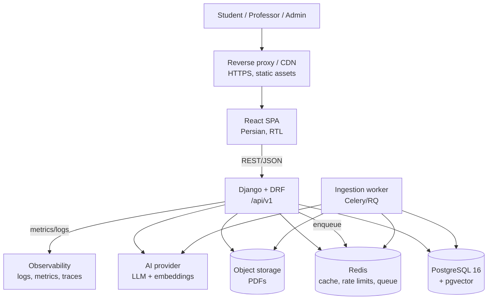
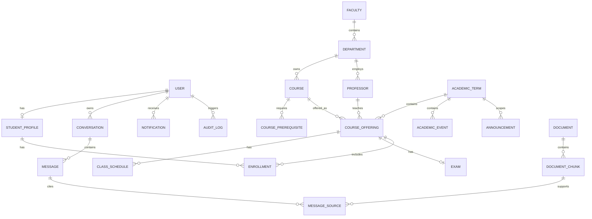

# Architecture — University Smart Assistant

**Status.** Proposed production architecture. It **extends and corrects** the
existing specification (`docs/02`, `03`, `05`, `06`, `07`, `09`, ADR-001…010).
Where I disagree with the current docs, the deviation is marked **C-nn** and
justified in §9. Nothing here contradicts `AGENTS.md`'s hard rules: React talks
only REST, the AI key never reaches the browser, schema changes only via
migrations, business rules live server-side.

---

## 1. Context and constraints

| Constraint | Consequence for the design |
|---|---|
| Persian-first, RTL, fa-IR (`AGENTS.md`, `docs/11`) | Document language, text normalization, Jalali dates, Persian typography and Persian numerals are cross-cutting, not cosmetic |
| University facts must be traceable to official sources (`AGENTS.md` §2) | Every answer path must carry evidence; the LLM is a renderer, not a source |
| Eligibility is deterministic (`docs/17`, `docs/18`) | Rules engine is pure, unit-testable, separate from any AI call |
| Small team, one repo, 17 phases | Monorepo, one CI, one compose file; no microservices |
| Sensitive student data | Server-side authorization everywhere, minimum data to the provider, retention policy |
| Documents are Persian PDFs of varying quality | Ingestion must tolerate OCR-less scans, tables and clause structure |

---

## 2. System context



**Trust boundaries.** Browser (untrusted, holds no secret and makes no
authorization decision) │ API (validation, permissions, rate limits, no internals
in responses) │ Worker (trusted, server-side) │ Data stores (never exposed) │
AI provider (receives minimized context, returns untrusted text).

---

## 3. Backend architecture

### 3.1 Layering (enforced, not advisory)

```
HTTP (DRF views/viewsets/serializers)   ← request/response only
  └── application services              ← orchestration, transactions, permissions
        └── domain (rules, entities)    ← pure logic, no HTTP, no ORM imports where avoidable
              └── infrastructure        ← repositories, pgvector, AI adapters, storage
```

Rules: a view may not contain business logic; a domain function may not import a
serializer; RAG code may not import DRF; the AI adapter is the only module that
knows a provider's wire format.

### 3.2 App boundaries (fills the gap flagged in V-02)

| App | Owns | Public surface |
|---|---|---|
| `accounts` | User, Role, refresh-token registry | `/auth/*` |
| `students` | StudentProfile, Enrollment | `/students/me/`, `/enrollments/` |
| `academics` | Faculty, Department, AcademicTerm | `/terms/`, `/faculties/`, `/departments/` |
| `courses` | Course, CoursePrerequisite, CourseOffering, ClassSchedule | `/courses/*`, `/course-offerings/*` |
| `professors` | Professor | `/professors/*` |
| `calendar` | AcademicEvent | `/calendar/events/` |
| `exams` | Exam | `/exams/*` |
| `announcements` | Announcement | `/announcements/*` |
| `documents` | Document, DocumentChunk | `/admin/documents/*` |
| `rag` | normalize, extract, chunk, embed, retrieve, rerank | internal service layer |
| `ai` | QuestionRouter, PromptService, LLMProvider, AnswerFormatter, CitationService | internal service layer |
| `conversations` | Conversation, Message, MessageSource | `/conversations/*` |
| `notifications` | Notification | `/notifications/*` |
| `analytics` | AuditLog, metrics aggregation | `/admin/analytics/*` |
| `common` | error envelope, request-id middleware, JSON logging, pagination, health | `/health/*`, `/metrics` |

### 3.3 Request pipeline (API)

```
Request
 → RequestContextMiddleware (X-Request-ID generate/validate, timer)
 → JSON structured access log
 → CORS / host / HTTPS checks
 → DRF authentication (JWT access)
 → DRF permission (IsAuthenticated default; explicit AllowAny only for health/auth)
 → throttle (per-scope: anon, user, ai, auth)
 → serializer validation (Persian messages)
 → application service (transaction boundary)
 → repository / retrieval / AI call
 → serializer response
 → error envelope on any failure (code stays English, message Persian)
```

**C-01 — Split health endpoints.** One `/health/` cannot express the three
different questions a load balancer, an orchestrator and an on-call engineer ask.
Use `/health/live` (process up, no dependency), `/health/ready` (DB reachable —
this is what the proxy routes on) and `/health/deep` (DB + pgvector + provider
reachability, admin/ops only). `/health/` stays as an alias of `/ready` for
backwards compatibility with the Phase 00 contract.

### 3.4 Configuration and secrets

**C-02 — Split settings.** One `settings.py` with env branching gets fragile in
production. Use `config/settings/{base,local,test,production}.py` with
`DJANGO_SETTINGS_MODULE` selected by environment; production fails fast on missing
`SECRET_KEY`, `ALLOWED_HOSTS`, `DATABASE_URL`, `CORS_ALLOWED_ORIGINS`.

Secrets come from the environment or a secret manager — never from the image,
never from the repo. `.env.example` stays the single documented list of names.

---

## 4. Data architecture

### 4.1 Entity model (corrected ERD)



**C-03 — `Announcement` is added to the ERD** (it existed as an entity in
`docs/03` with no relationships) and gains `term` (nullable = university-wide),
`audience` (faculty/department/program, nullable = all) and expiry semantics,
because "students view active announcements" is unanswerable without them.

### 4.2 Constraints and indexes (fills the `docs/03` gap — V-14)

| Invariant | Enforcement |
|---|---|
| At most one current term | partial unique index on `AcademicTerm(is_current) WHERE is_current` |
| One section per course per term | unique `(course, term, section_code)` |
| One enrollment per student per offering | unique `(student, course_offering)` |
| One exam per offering | `OneToOneField` |
| Stable codes | unique `Course.code`, `(faculty, code)`, `(department, code)` |
| Valid time ranges | `CHECK (starts_at < ends_at)` on events, exams, schedules, terms |
| No self-prerequisite | `CHECK (course_id <> prerequisite_course_id)` |

Indexes, each tied to a real query: `Course.code` · `CourseOffering(term, course)`
and `(term, professor)` · `Exam.course_offering` · `AcademicEvent(term, starts_at)`
· `Enrollment(student, status)` · `Conversation(user, updated_at)` ·
`Message(conversation, created_at)` · `Announcement(is_published, expires_at)` ·
`Document(status, academic_year)` · `DocumentChunk(document, chunk_index)`.

Over-indexing is a real cost — every index above must be re-checked with `EXPLAIN`
once realistic data exists, and dropped if unused.

### 4.3 Vector storage

**C-06 — Pin the dimension and use HNSW.** `docs/03` leaves the column type open
and `docs/06` says "create the appropriate index after measuring". In practice the
dimension must be fixed **before** the first migration, because changing it means
re-embedding the corpus. Recommendation:

- `embedding vector(N)`, with `N` a constant asserted at startup against the
  configured model — a mismatch must fail loudly, not silently degrade.
- Store `embedding_model` and `embedding_dim` on `DocumentChunk` so a mixed corpus
  is detectable.
- **HNSW** (`vector_cosine_ops`, `m=16`, `ef_construction=64`) from the start:
  better recall/latency than IVFFlat without a training step, at the cost of slower
  builds and more memory.
- Keep `ef_search` tunable by env so recall/latency can be traded without a migration.

### 4.4 Persian search

**C-05 — Normalize once, store twice, search with trigrams.** `ILIKE` over raw
Persian text fails on exactly the character variants `docs/11` calls out. Design:

1. `normalize_persian(text)`: ی/ي→ی, ک/ك→ک, ه/ۀ→ه, strip tatweel, Arabic-Indic
   digits→ASCII, normalize ZWNJ (نیم‌فاصله) and punctuation.
2. Store `normalized_*` columns, written on save and never computed per request;
   for chunks this normalized text is what gets embedded.
3. Query: normalize the input with the same function, then `pg_trgm` similarity
   (`GIN (normalized_title gin_trgm_ops)`) plus prefix matching.
4. The same normalizer serves RAG retrieval, so search and retrieval agree — a
   mismatch here is the classic cause of "the document exists but the assistant
   says it does not".

---

## 5. Frontend architecture

**C-10 — Chosen stack** (each addition justified, per `AGENTS.md` rule 10):
React 19 + TypeScript + Vite · **React Router** · **TanStack Query** (server state:
caching, retries, invalidation, cancellation — hand-rolled `useEffect` fetching is
where most UI bugs come from) · **react-hook-form** (forms + validation) ·
**generated API client** from OpenAPI (C-07) · **MSW** (API mocking in tests) ·
**Vitest + Testing Library** · **Playwright** (E2E) · **axe** (accessibility) ·
**Vazirmatn** self-hosted subset.

### 5.1 Layers

```
app/            routing, providers, error boundary, layout shell
features/<x>/   screens + feature components + hooks + api calls
components/     design-system primitives (Button, Table, Field, Modal, Toast…)
lib/            api client, query keys, formatters (Jalali, Persian digits), normalizer
i18n/fa.ts      every user-facing string + error-code → Persian map
styles/         tokens + global RTL stylesheet (logical properties only)
```

Rules: no `fetch` outside `lib/api`; no business rule inside a component; no
inline Persian string; every async surface renders loading/empty/error/success.

### 5.2 UI quality bar ("great UI")

- Design tokens first (colour, spacing, radius, shadow, type scale) — no ad-hoc
  values in components.
- Vazirmatn with Persian line-height (≥ 1.75) and a numeral policy: Persian digits
  for display, Latin digits accepted on input for codes (student number, course code).
- Skeleton loaders for content areas instead of spinners; optimistic updates for
  safe actions (rename, read-state); toasts for outcomes.
- Empty states that state the next action; error states that offer retry and show
  the correlation id for support.
- RTL-correct icons/chevrons/progress; logical properties only.
- Responsive from 360 px up; tables collapse to cards on small screens.
- Dark mode is a token swap, not a second stylesheet — recommended for MVP because
  it is nearly free once tokens exist.

---

## 6. AI / RAG architecture

### 6.1 Provider adapter contract

```
class LLMProvider(Protocol):
    def chat(messages, *, temperature, max_tokens, timeout) -> ChatResult
    def embed(texts: list[str], *, batch_size) -> list[list[float]]
    def health() -> ProviderHealth

class ChatResult:  text, model, prompt_tokens, completion_tokens, latency_ms, finish_reason
```

Requirements: explicit timeouts, bounded retries with backoff on 429/5xx only,
circuit breaker so a dead provider degrades instead of hanging, token/cost
accounting per request, and a fake provider used by the entire test suite so tests
never call a real API.

**C-07 — OpenAPI as the contract, with generated clients.** `docs/04` is prose;
nothing prevents FE/BE drift. Add `drf-spectacular`, publish `/api/schema/`, commit
`openapi.yaml`, fail CI on an unreviewed schema change, and generate the frontend
types/client from it. This is the cheapest way to keep "healthy APIs" true over 17
phases.

### 6.2 Grounding and refusal

- Similarity threshold plus a **minimum evidence count**; below it, refuse in
  Persian ("شواهد رسمی کافی پیدا نشد") instead of guessing.
- Evidence is passed in a delimited block, explicitly labelled as untrusted data;
  system rules are never assembled from retrieved text.
- Post-generation citation validation: any cited id not present in the evidence set
  is dropped and the answer flagged.
- `STRUCTURED` answers bypass the LLM entirely when the question maps to a known
  query shape; the LLM only renders Persian prose around facts it was given.
- Eligibility-style questions never reach the LLM for a decision (Phase 11).

### 6.3 Evaluation

Golden dataset (`docs/15` §3) run as a CI job from Phase 08 onwards: retrieval
hit-rate, source correctness, citation integrity, refusal correctness, Persian
language quality. A prompt/model/chunking change without a green run does not merge.

---

## 7. Security architecture

| Layer | Controls |
|---|---|
| Transport | HTTPS only, HSTS, secure cookies, HTTP→HTTPS redirect |
| Identity | Argon2 hashing, short access TTL, refresh rotation + reuse detection, logout revocation, rate-limited login/refresh |
| Session | Refresh in HttpOnly + Secure + SameSite cookie; access in memory only; CSRF protection on the cookie-driven refresh endpoint |
| Authorization | Per-endpoint permission classes; object-level scoping by queryset (conversations, profile); admin surfaces server-enforced |
| Input | Serializer validation, strict upload validation (extension + MIME + magic bytes + size), filename sanitisation, request size caps |
| Data | Least-privilege DB role per service; encryption at rest where the host supports it; no PII in logs |
| AI | Key server-side only; minimized context to the provider; retrieved text untrusted; injection suite in CI; per-user quotas |
| Storage | Uploads outside executable paths, served through the API/proxy with authorization, never by direct filesystem path |
| Dependencies | Pinned versions, `pip-audit` + `npm audit` in CI, documented upgrade path |
| Operations | Secret manager/env only, no secret in images, backups encrypted, audit log append-only |

**C-08 — Auth hardening beyond `docs/05`.** The spec stops at "refresh cookie +
in-memory access". Production needs: refresh **rotation** with reuse detection (a
stolen refresh token must be detectable), a server-side refresh registry so logout
is real, CSRF defence for the refresh endpoint (double-submit token), and Argon2
instead of PBKDF2. Without rotation, "logout" and "revoke" are aspirational.

---

## 8. Observability and SLOs

**C-09 — Three pillars, minimal footprint.**

- **Logs:** JSON, one line per request (request id, user id hash, method, path,
  status, latency, error code) plus AI/ingestion detail lines. No tokens, no
  passwords, no raw student data.
- **Metrics:** Prometheus endpoint (internal only) exposing request latency
  histograms by route, error counters by code, DB pool/query time, queue depth,
  ingestion duration, provider latency/failures, token usage.
- **Traces:** OpenTelemetry spans API → service → DB → provider, correlated by the
  same request id already implemented in the baseline. Optional for MVP, but the
  request id must be threaded through from day one (it already is).

**Proposed SLOs** (documented, alertable — numbers to be confirmed after the first
load test):

| Service | SLI | Target |
|---|---|---|
| API reads | p95 latency | < 300 ms |
| Ask endpoint (non-streaming) | p95 latency | < 8 s |
| API availability | successful requests | ≥ 99.5% monthly |
| Ingestion | document indexed within | < 5 min for a 50-page PDF |
| Error budget | 5xx rate | < 1% of requests |

**Alerting:** 5xx rate, provider failure rate, queue backlog, DB connection
exhaustion, disk/volume usage, failed ingestion jobs, backup failure.

---

## 9. Deviations from the current documentation (summary)

| ID | Current doc says | Proposed | Why |
|---|---|---|---|
| C-01 | one `/health/` endpoint | `/health/live`, `/health/ready`, `/health/deep` | Different consumers need different questions; a provider outage must not mark the app unready |
| C-02 | single `settings.py` with env branching | `settings/{base,local,test,production}.py` | Production must fail fast and be auditable; branching in one file hides misconfiguration |
| C-03 | `Announcement` entity without relationships | add `term`, `audience`, expiry, ERD edge | "Active announcements for my term" needs scoping |
| C-04 | files on local disk | object storage with a local adapter for tests | Multi-replica safe, backup/restore friendly, no path leakage |
| C-05 | search unspecified; `ILIKE`-style assumed | Persian normalizer + stored normalized columns + `pg_trgm` | Character variants otherwise break search and retrieval |
| C-06 | vector index chosen "after measuring" | pin dimension now, HNSW from the start | Dimension changes force a full re-embed; HNSW avoids IVFFlat training |
| C-07 | API contract as prose | OpenAPI + committed schema + generated FE client | Detects FE/BE drift automatically |
| C-08 | refresh cookie + in-memory access | + rotation, reuse detection, refresh registry, CSRF, Argon2 | Makes logout/revocation real |
| C-09 | "structured logs" | JSON logs + Prometheus metrics + request-id traces + SLOs/alerts | Monitoring is a requirement, not a nice-to-have |
| C-10 | "React + TypeScript" | + Router, TanStack Query, react-hook-form, MSW, Playwright, axe | Deterministic data/forms/testing story; a11y enforced |
| C-11 | document processing in-request | background worker + queue | Request timeouts on real PDFs |
| C-12 | `DATABASE_URL` fallback to SQLite | keep SQLite for local/tests only; Postgres required for staging/prod, enforced in CI | SQLite hides pgvector/JSON/constraint behaviour |

Nothing in C-01…C-12 violates `AGENTS.md`: no new infrastructure is assumed without
an ADR (Redis/worker = ADR-011, OpenAPI = ADR-012, frontend data layer = ADR-013,
object storage = ADR-014).

---

## 10. Deployment topology

```
Internet
   │
   ▼
Reverse proxy (nginx/Caddy)  ── TLS, HSTS, CSP, gzip/brotli, static caching
   ├── /            → React static bundle (built image or CDN)
   ├── /api/        → Django (gunicorn, N workers, non-root)
   ├── /admin/      → Django admin (optional, IP-restricted) 
   └── /metrics     → internal only (never public)
                        │
        ┌───────────────┼────────────────┐
        ▼               ▼                ▼
   PostgreSQL 16    Redis           Object storage
   (+pgvector)      cache/queue     (documents)
        │
        ▼
   Worker (Celery/RQ) ── ingestion, embeddings, retries
        │
        ▼
   AI provider (LLM + embeddings)
```

**Environments:** local (SQLite or compose Postgres, fake provider) · CI (Postgres
+ pgvector service, fake provider) · staging (production-like, seeded, real
provider, no student PII) · production.

**Release sequence:** build tagged images → run migrations as a separate job →
deploy API + worker → deploy frontend → readiness check → smoke test → monitor →
rollback on failure (previous image; migrations must be backward compatible for one
release).

---

## 11. Decisions this architecture needs from you

| # | Decision | Recommended default | Impact if deferred |
|---|---|---|---|
| A-1 | Background worker + Redis (ADR-011) | Accept: Celery + Redis | Ingestion stays in-request and will time out on real PDFs |
| A-2 | Object storage (ADR-014) | Accept: S3-compatible, local adapter for dev | Disk-based uploads break with >1 replica and complicate backup |
| A-3 | Frontend data layer (ADR-013) | Accept: TanStack Query | Every page reinvents caching/retry; UI bugs multiply |
| A-4 | OpenAPI + generated client (ADR-012) | Accept | FE/BE drift stays invisible until integration |
| A-5 | Embedding model + dimension (OA-05) | Decide before Phase 08 | Blocks the pgvector migration; late change = re-embed everything |
| A-6 | Metrics stack (C-09) | Prometheus + Grafana, logs to file/stdout | No alerting means outages are found by users |
| A-7 | Cache layer scope | Start with HTTP caching + query cache; add Redis caching later | Over-caching early creates stale-data bugs |
| A-8 | Faculty/term scoping of student visibility | Students see published data for their own faculty + university-wide | Wrong assumption here is a data-exposure bug, not a UI bug |
| A-9 | Dark mode | Include in Phase 05 token work | Cheap now, a refactor later |
| A-10 | Analytics storage | Compute on demand for MVP; materialise only if slow | Premature materialisation adds a moving part |


