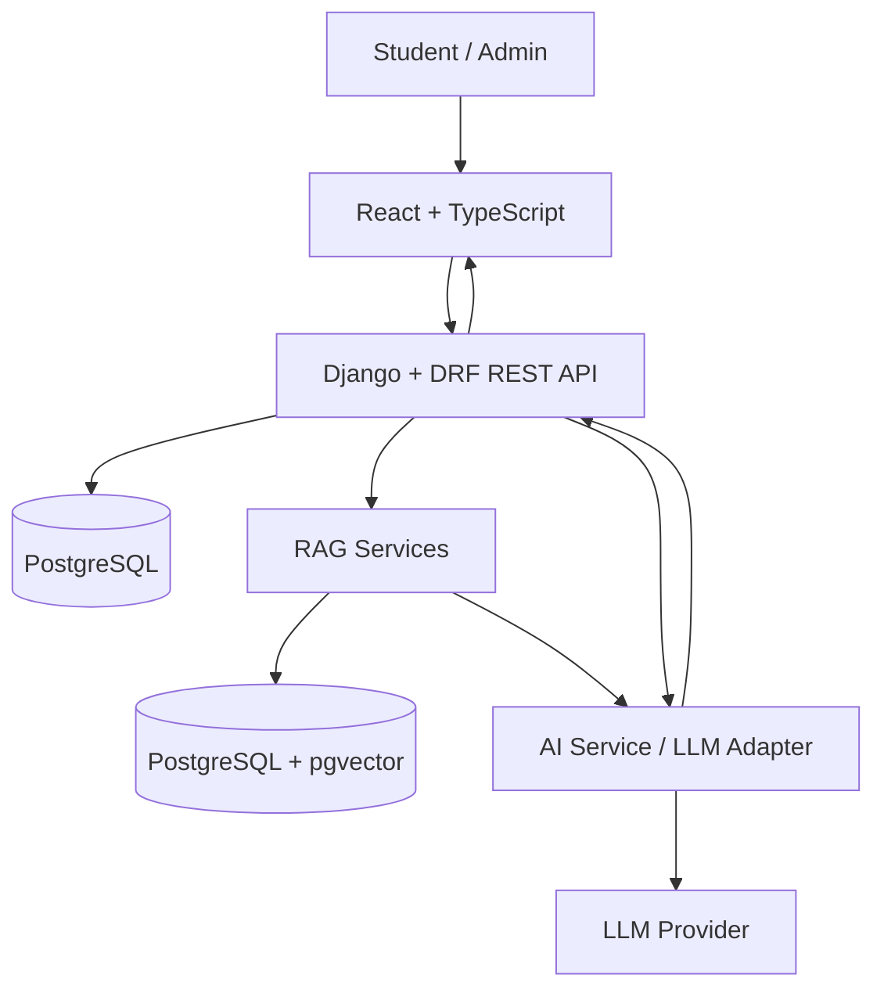

# 02 — System Architecture

## 1. High-level architecture



## 2. Backend responsibilities

Django is responsible for:

- authentication and authorization
- CRUD APIs
- academic business rules
- document lifecycle
- RAG orchestration
- AI provider integration
- auditing
- validation

## 3. Frontend responsibilities

React is responsible for:

- rendering screens
- local UI state
- form handling
- API integration
- route protection at UI level
- displaying loading/error/empty states
- rendering citations and structured answers

UI protection is not a security boundary; the server remains authoritative.

## 4. Suggested backend modules

```text
backend/
  config/
  apps/
    accounts/
    students/
    academics/
    courses/
    professors/
    calendar/
    exams/
    announcements/
    conversations/
    documents/
    rag/
    ai/
    notifications/
    analytics/
    common/
```

Apps may be consolidated or split based on implementation experience, but boundaries should remain clear.

## 5. AI execution modes

### Structured

Used for factual queries over normalized data, such as exams, course offerings, schedules, and professors.

### RAG

Used for policy/regulation/manual questions and other official unstructured documents.

### Hybrid

Used when a question needs both database facts and document rules.

### General

Used only for generic educational or explanatory content not presented as official university policy.

### Out of scope

Used when the system cannot safely answer from its supported domain.

## 6. Request flow

```text
HTTP Request
   -> DRF endpoint
   -> Authentication / permissions
   -> serializer validation
   -> application service
   -> domain/repository operations
   -> optional retrieval
   -> optional AI generation
   -> response serializer
   -> HTTP response
```

## 7. Design constraints

- Database access stays server-side.
- AI secrets stay server-side.
- API contracts are versioned.
- Academic facts that change by term are modeled historically.
- AI responses should be traceable to evidence for university-specific facts.
