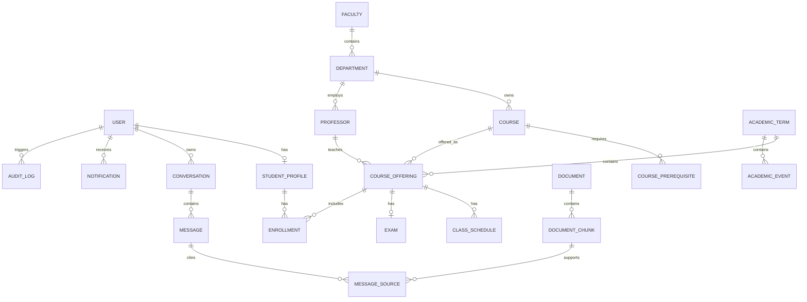

# 03 — Database Design

## 1. Principles

- Normalize core academic data.
- Preserve historical academic records.
- Make time-dependent data explicitly term-aware.
- Use foreign keys for relationships.
- Use status fields for lifecycle state.
- Store source/version metadata for documents.

## 2. ERD

## 3. Core entities

### User

Authentication identity. Typical fields:

- id
- email/username according to policy
- password hash
- is_active
- is_staff
- role
- created_at
- updated_at

### StudentProfile

Academic attributes linked to a User:

- user
- student_number
- faculty
- department
- degree_level
- entry_year
- current_term_number
- current_gpa

### Faculty

- name
- code
- is_active

### Department

- faculty
- name
- code
- is_active

### Course

- department
- code
- title
- credits
- course_type
- active

### CoursePrerequisite

- course
- prerequisite_course
- rule_type

`rule_type` can initially support `REQUIRED` and be extended later.

### AcademicTerm

- name
- academic_year
- semester_type
- starts_at
- ends_at
- is_current

### Professor

- department
- first_name
- last_name
- academic_title
- email
- office
- bio
- is_active

### CourseOffering

- course
- term
- professor
- section_code
- capacity
- status

### ClassSchedule

- course_offering
- weekday
- start_time
- end_time
- classroom

### Exam

- course_offering
- starts_at
- ends_at
- classroom
- status
- last_updated_at

### Enrollment

Represents a student's relationship with a course offering.

- student
- course_offering
- status
- grade
- enrolled_at

Suggested status values:

- `ENROLLED`
- `PASSED`
- `FAILED`
- `DROPPED`
- `WITHDRAWN`

### AcademicEvent

- term
- title
- event_type
- starts_at
- ends_at
- description
- is_published

### Announcement

- title
- body
- priority
- published_at
- expires_at
- is_published

### Document

- title
- document_type
- file_path / storage reference
- academic_year
- effective_from
- effective_to
- version
- status
- checksum
- uploaded_by
- created_at

### DocumentChunk

- document
- chunk_index
- content
- page_number
- section_title
- token_count
- embedding

The embedding column uses pgvector.

### Conversation

- user
- title
- created_at
- updated_at
- archived_at

### Message

- conversation
- role (`USER`, `ASSISTANT`, optionally `SYSTEM` internally)
- content
- retrieval_mode
- created_at
- latency_ms

### MessageSource

- message
- document_chunk
- source_label
- relevance_score
- citation_text

### Notification

- user
- title
- body
- type
- is_read
- created_at

### AuditLog

- actor
- action
- entity_type
- entity_id
- metadata
- created_at

## 4. Important indexes

Recommended early indexes:

- Course.code
- Professor last name / department
- CourseOffering.term + course
- CourseOffering.term + professor
- Exam.course_offering
- AcademicEvent.term + starts_at
- Document.status + academic_year
- DocumentChunk.document + chunk_index
- Conversation.user + updated_at
- Notification.user + is_read

Exact index strategy must be validated against actual queries before over-indexing.

## 5. Historical correctness

Never overwrite old exam/schedule facts merely because the current term changed. Each offering/exam is attached to a specific academic term. Documents similarly require effective/version metadata.
